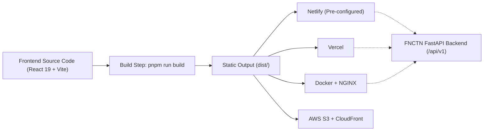

# FNCTN Frontend — Run & Deployment Guide

This guide provides instructions on how to run the FNCTN Frontend locally, resolves common terminal errors, outlines project architecture, and provides a complete production deployment plan.

---

## 1. Quick Start: How to Run Locally

### Why Your Previous Commands Failed
In your previous terminal session:
1. **Typo in the package manager command**: `pnmp run dev` was typed instead of `pnpm run dev` (`pnmp` does not exist).
2. **Wrong working directory**: You changed directory into `src/` (`cd src`). In Node.js / Vite projects, `package.json` resides in the `Frontend/` root folder. Running scripts from `src/` fails because `package.json` cannot be found there.
3. **PowerShell execution error**: Running `run dev` is not a valid terminal command; PowerShell attempts to run an executable named `run`, which does not exist.

> [!NOTE]
> Your machine has all required tools installed and verified:
> - **Node.js**: `v24.16.0`
> - **pnpm**: `9.15.5`
> - **npm**: `11.13.0`

---

### Step-by-Step Execution (PowerShell / Windows Terminal)

#### Step 1: Open Terminal in the `Frontend` Root
If you are currently inside `Frontend/src`, navigate up one level:
```powershell
cd c:\Users\user\Desktop\Freelancing\FNCTN\FNCTN\Frontend
```
*(Or if you are in `FNCTN\Frontend\src`, simply run `cd ..`)*

#### Step 2: Ensure Dependencies Are Installed (Optional)
Dependencies are already installed in `node_modules`, but if you ever pull updates or delete `node_modules`:
```powershell
pnpm install
```
*(Or with npm: `npm install`)*

#### Step 3: Start the Development Server
```powershell
pnpm run dev
```
*(Or with npm: `npm run dev`)*

#### Step 4: Open in Your Browser
Once started, Vite will output:
```
  VITE v8.0.5  ready in 828 ms

  ➜  Local:   http://localhost:8443/
  ➜  Network: http://192.168.x.x:8443/
```
Open **`http://localhost:8443`** in your browser.

> [!IMPORTANT]
> **Default Port is 8443:**  
> In `vite.config.ts`, the dev server port is set to `process.env.PORT || '8443'`.  
> If you wish to run on standard port `5173` or `3000`, specify it via environment variable:
> ```powershell
> $env:PORT="5173"; pnpm run dev
> ```

---

## 2. Available NPM / PNPM Scripts

All scripts must be executed from the `Frontend` directory (`c:\Users\user\Desktop\Freelancing\FNCTN\FNCTN\Frontend`):

| Command | Purpose |
| :--- | :--- |
| `pnpm run dev` | Starts the Vite development server with Hot Module Replacement (HMR) on port 8443 |
| `pnpm run build` | Compiles TypeScript and builds production-ready static assets into `Frontend/dist/` |
| `pnpm run preview` | Locally serves the production `dist/` directory to test the production bundle before deploying |
| `pnpm run format` | Runs `oxfmt` to format TypeScript and JSX source files |

---

## 3. Technology Stack & Architecture

- **Framework**: React 19 (`react`, `react-dom`)
- **Language**: TypeScript (`^5.7.0`)
- **Bundler & Dev Server**: Vite 8 (`vite`, `@vitejs/plugin-react`)
- **Styling**: Tailwind CSS v4 (`@tailwindcss/vite` imported directly in `src/index.css`)
- **Entry Points**:
  - HTML Shell: `index.html`
  - React Entry: `src/main.tsx`
  - Root Component: `src/App.tsx`
  - Global Styles: `src/index.css`
- **State & Services**:
  - `src/services/auth.ts`: Standalone client-side authentication and mock persistence using `localStorage`.

---

## 4. Production Deployment Plan

The frontend is a **Single-Page Application (SPA)** compiled into pure static HTML, CSS, and JavaScript. It does not require a Node.js server runtime in production and can be hosted on any high-performance static hosting platform or CDN.



---

### Strategy 1: Netlify (Recommended & Already Configured)

This repository already includes pre-configured `netlify.toml` files at both the repository root and `Frontend/`.

#### Pre-configuration details:
```toml
[build]
  base = "Frontend"
  publish = "dist"
  command = "pnpm run build"

[[redirects]]
  from = "/*"
  to = "/index.html"
  status = 200
```

#### Deployment Methods:

##### Method A: Automated Deployment via GitHub (Zero-Touch CI/CD)
1. Push the project repository to GitHub (`main` branch).
2. Log into [Netlify](https://app.netlify.com/).
3. Click **"Add new site"** > **"Import an existing project"** > Choose **GitHub**.
4. Select your `FNCTN` repository.
5. Netlify will auto-detect settings from `netlify.toml`:
   - **Base directory**: `Frontend`
   - **Build command**: `pnpm run build`
   - **Publish directory**: `Frontend/dist`
6. Click **Deploy Site**. Every subsequent `git push` to `main` will build and deploy automatically.

##### Method B: Manual Deployment via Netlify CLI
From the `Frontend` directory:
```powershell
# 1. Build the production bundle
pnpm run build

# 2. Deploy directly using Netlify CLI without global install
pnpm dlx netlify-cli deploy --prod --dir=dist
```

---

### Strategy 2: Vercel

Vercel provides edge hosting with automatic previews for pull requests.

1. Install Vercel CLI (or use the Vercel Web Dashboard):
   ```powershell
   pnpm dlx vercel
   ```
2. Configure settings when prompted:
   - **Root Directory**: `Frontend`
   - **Framework Preset**: `Vite`
   - **Build Command**: `pnpm run build`
   - **Output Directory**: `dist`
3. For SPA client-side routing on Vercel, ensure a `vercel.json` exists in `Frontend/`:
   ```json
   {
     "rewrites": [
       { "source": "/(.*)", "destination": "/index.html" }
     ]
   }
   ```

---

### Strategy 3: Self-Hosted Docker Container (NGINX)

For enterprise or VPS environments (DigitalOcean, AWS EC2, Hetzner):

Create `Frontend/Dockerfile`:
```dockerfile
# Stage 1: Build static assets
FROM node:22-alpine AS builder
WORKDIR /app
RUN corepack enable && corepack prepare pnpm@latest --activate
COPY package.json pnpm-lock.yaml ./
RUN pnpm install --frozen-lockfile
COPY . .
RUN pnpm run build

# Stage 2: Serve with NGINX Alpine
FROM nginx:alpine
COPY --from=builder /app/dist /usr/share/nginx/html
COPY nginx.conf /etc/nginx/conf.d/default.conf
EXPOSE 80
CMD ["nginx", "-g", "daemon off;"]
```

Create `Frontend/nginx.conf` (ensures SPA routing fallback):
```nginx
server {
    listen 80;
    server_name localhost;

    location / {
        root /usr/share/nginx/html;
        index index.html index.htm;
        try_files $uri $uri/ /index.html;
    }

    error_page 500 502 503 504 /50x.html;
    location = /50x.html {
        root /usr/share/nginx/html;
    }
}
```

Build and run:
```powershell
docker build -t fnctn-frontend .
docker run -d -p 80:80 fnctn-frontend
```

---

## 5. Connecting Frontend with Backend in Production

### 1. Environment Variable Configuration
When migrating from mock client authentication (`src/services/auth.ts`) to the live FastAPI backend:

Create `Frontend/.env.production`:
```env
VITE_API_BASE_URL=https://api.fnctn.com/api/v1
```

Access in TypeScript code:
```typescript
const API_BASE_URL = import.meta.env.VITE_API_BASE_URL || 'http://localhost:8000/api/v1';
```

### 2. Backend CORS Configuration
Ensure the FastAPI backend (`Backend/src/main.py`) allows requests from your deployed frontend domain:
```python
from fastapi.middleware.cors import CORSMiddleware

origins = [
    "http://localhost:8443",
    "http://localhost:5173",
    "https://fnctn.netlify.app",
    "https://yourcustomdomain.com"
]

app.add_middleware(
    CORSMiddleware,
    allow_origins=origins,
    allow_credentials=True,
    allow_methods=["*"],
    allow_headers=["*"],
)
```

---

## 6. Pre-Deployment Verification Checklist

Before releasing to production:
- [ ] Run `pnpm run build` to confirm zero TypeScript compilation errors.
- [ ] Test the production bundle locally using `pnpm run preview`.
- [ ] Verify SPA fallback redirects (visiting deep links directly like `/tournaments` must return `index.html` without 404).
- [ ] Verify environment variables are configured on your hosting platform dashboard.
- [ ] Verify CORS headers allow the frontend domain on the FastAPI backend.
- [ ] Confirm assets, images, and fonts load correctly over HTTPS without mixed-content warnings.
